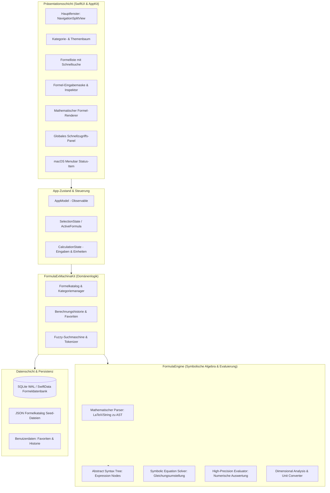

# Formula ex Machina – Software-Architektur

Die Software-Architektur von **Formula ex Machina** folgt den Grundsätzen des Clean Architecture & Domain-Driven Design (DDD), optimiert für native macOS-Entwicklung mit **Swift 6** und **SwiftUI**.

---

## 1. Architektur-Prinzipien

1. **Strikte Entkopplung der mathematischen Kern-Engine (`FormulaEngine`)**:
   - Die Algebra-Engine besitzt keinerlei Abhängigkeiten zu SwiftUI oder AppKit.
   - Sie ist rein funktional, zustandslos und deterministisch.
   - Jede Formelumstellung und Auswertung ist unit-testbar (`[unit]`) und thread-sicher (`Sendable`).

2. **Reaktive Einweg-Datenarchitektur (Unidirectional Data Flow)**:
   - Der Zustand wird im `@Observable` `AppModel` gehalten.
   - Änderungen an Eingabewerten oder der ausgewählten Zielvariable fließen in die `FormulaEngine`, welche synchron oder asynchron die isolierte Formel und das numerische Ergebnis liefert.
   - Die UI reagiert ausschließlich auf publizierte Zustandsänderungen.

3. **Swift 6 Concurrency & Isolation**:
   - UI-Komponenten laufen standardmäßig isoliert auf dem `@MainActor`.
   - Aufwändige algebraische Umformungen oder das Parsen großer Datenbestände finden in `nonisolated` oder abgetrennten Tasks statt, sodass das User Interface stets butterweich mit 120 Hz (ProMotion) agiert.

4. **100 % Lokale Datenhoheit & Offline-First**:
   - Alle Formeln, Beschreibungen, Konstanten und Einheiten sind fest kompilierte oder lokal gespeicherte Ressourcen.
   - Kein Netzwerktraffic für Kernfunktionen.

---

## 2. Die Module im Detail

### 2.1 FormulaEngine (Symbolic Math Core)
- **`MathAST`**:
  Definiert die mathematische Baumstruktur:
  - `Node.number(Decimal)`
  - `Node.symbol(String)`
  - `Node.constant(PhysicalConstant)`
  - `Node.binary(op: BinaryOperator, left: Node, right: Node)`
  - `Node.unary(op: UnaryOperator, child: Node)`
  - `Node.function(name: MathFunction, argument: Node)` (z. B. $\sin, \cos, \ln, \exp, \sqrt{}$)
  - `Node.power(base: Node, exponent: Node)`
  - `Node.fraction(numerator: Node, denominator: Node)`
- **`SymbolicSolver`**:
  Verantwortlich für das Umstellen von Gleichungen:
  - Eingabe: Eine Gleichung $L = R$ und eine Zielvariable $x$.
  - Algorithmus: Prüft das Vorkommen von $x$. Wendet Umformungsregeln an (Äquivalenzumformungen):
    - Addition / Subtraktion von Termen auf beiden Seiten
    - Multiplikation / Division zur Beseitigung von Brüchen
    - Wurzelziehen oder Exponentiation
    - Ausklammern / Faktorisieren bei mehrfachem Auftreten von $x$
  - Ausgabe: Isolierte Formel $x = f(\dots)$ sowie eine Sequenz von Erklärungsschritten (`[TransformationStep]`).
- **`UnitEngine`**:
  - Modelliert physikalische Dimensionen $[M]^a [L]^b [T]^c [I]^d [\Theta]^e [N]^f [J]^g$.
  - Wandelt Einheiten automatisch in SI-Basiseinheiten um und konvertiert das Endergebnis in die vom Anwender gewünschte Zieleinheit (z. B. $\text{km/h} \leftrightarrow \text{m/s}$, $\text{kJ} \leftrightarrow \text{kWh}$, $\text{psi} \leftrightarrow \text{bar}$).
  - Verhindert Dimensionsfehler (z. B. Addition von Länge und Zeit).

### 2.2 FormulaExMachinaKit (Domänenschicht)
- **`Formula`**: Hauptmodell mit Metadaten, LaTeX-String, AST-Referenz, Variablenbeschreibungen, Standard-Einheiten und Fachbereich.
- **`FormulaCatalog`**: Lädt die Formelsammlung aus vorkompiliertem SQLite / JSON.
- **`FormulaSearchEngine`**: Unterstützt Tokensuche, Prefix-Matching und Synonyme (z. B. Eingabe von `v` findet auch "Geschwindigkeit", `F=m*a` findet "2. Newtonsches Axiom").
- **`CalculationHistoryManager`**: Speichert die letzten Berechnungen mit allen eingegebenen Werten.

### 2.3 FormulaExMachina (App & UI)
- **`NavigationSplitView`**:
  - **Sidebar**: Klare Kategorien und Unterthemen mit Icons.
  - **Content (Mitte)**: Durchsuchbare Liste aller Formeln des gewählten Themas mit Schnellvorschau.
  - **Detail (Rechts)**: Interaktive Formelmaske.
- **Formelmaske (Formula Detail View)**:
  - Formelansicht mit scharfem Vektor-Rendering.
  - Dropdown-Menü: **"Formel umstellen nach:"** mit allen in der Formel vorkommenden Variablen.
  - Dynamische Eingabefelder mit Live-Validierung und Einheiten-Auswahlmenü.
  - Schritt-für-Schritt-Ansicht der Umformung auf Wunsch einblendbar.
  - "In Zwischenablage kopieren"-Aktionen (als Wert, mit Einheit, als LaTeX oder als Swift-Code).
- **macOS System-Integration**:
  - Tastaturbedienung: Navigation vollständig ohne Maus möglich (`Tab`, `⌘↩` zum Berechnen, `⌘F` zum Suchen).
  - Schnellzugriffs-Panel (Overlay).

---

## 3. Datenbank- & Speicherdesign

- **Format:** SQLite 3 mit WAL (Write-Ahead-Logging) für höchste Lesegeschwindigkeit und Robustheit.
- **Schema:**
  - `categories (id, name, icon, sort_order)`
  - `subcategories (id, category_id, name, sort_order)`
  - `formulas (id, subcategory_id, name, latex, ast_json, description)`
  - `variables (id, formula_id, symbol, name, default_unit, dimension)`
  - `constants (id, symbol, name, value, unit)`
  - `user_favorites (formula_id, created_at, tags)`
  - `calculation_history (id, formula_id, target_variable, inputs_json, result, result_unit, timestamp)`
