# Formula ex Machina – Formel-Taxonomie & Wissensbestand

Die Formeldatenbank von **Formula ex Machina** ist modular und hierarchisch nach Fachgebieten strukturiert. Jede Formel ist mit Symbolen, SI-Basiseinheiten, abgeleiteten Einheiten, Beschreibungen und Umformungsvorschriften hinterlegt.

```mermaid
graph TD
    Root[Formula ex Machina Wissensdatenbank]
    Root --> Phys[1. Physik]
    Root --> Math[2. Mathematik]
    Root --> Chem[3. Chemie]
    Root --> EE[4. Elektrotechnik]
    Root --> Eng[5. Maschinenbau & Statik]
    Root --> Fin[6. Finanzmathematik]
    Root --> Astro[7. Astronomie & Raumfahrt]

    Phys --> P1[Kinematik & Dynamik]
    Phys --> P2[Arbeit, Energie & Leistung]
    Phys --> P3[Thermodynamik & Gase]
    Phys --> P4[Optik & Wellen]
    Phys --> P5[Relativität & Quanten]

    Math --> M1[Geometrie 2D & 3D]
    Math --> M2[Trigonometrie]
    Math --> M3[Algebra & Gleichungen]
    Math --> M4[Analysis & Reihen]

    EE --> E1[Gleichstrom & Ohmsches Gesetz]
    EE --> E2[Wechselstrom & Scheinleistung]
    EE --> E3[Elektromagnetismus]

    Chem --> C1[Stöchiometrie & Konzentrationen]
    Chem --> C2[Gasgesetze]
    Chem --> C3[Thermodynamik & Kinetik]

    Fin --> F1[Zinseszins & Barwert]
    Fin --> F2[Annuitäten & Kredittilgung]
```

---

## 1. Physik (`physics`)

### 1.1 Kinematik (Bewegungslehre)
- **Gleichförmige Bewegung**: $s = v \cdot t$ (Umstellbar nach $v = \frac{s}{t}, t = \frac{s}{v}$)
- **Gleichmäßig beschleunigte Bewegung**: $v = v_0 + a \cdot t$ (Umstellbar nach $a = \frac{v - v_0}{t}, t = \frac{v - v_0}{a}$)
- **Weg-Zeit-Gesetz**: $s = v_0 \cdot t + \frac{1}{2} a \cdot t^2$
- **Geschwindigkeit-Weg-Beziehung**: $v^2 = v_0^2 + 2 a \cdot s$
- **Kreisbewegung / Zentripetalbeschleunigung**: $a_z = \frac{v^2}{r} = \omega^2 \cdot r$
- **Winkelgeschwindigkeit**: $\omega = 2 \pi \cdot f = \frac{2 \pi}{T}$

### 1.2 Dynamik (Kräfte & Masse)
- **2. Newtonsches Axiom (Grundgesetz)**: $F = m \cdot a$ (Umstellbar nach $m = \frac{F}{a}, a = \frac{F}{m}$)
- **Gewichtskraft**: $F_G = m \cdot g$
- **Gravitationsgesetz (Newton)**: $F = G \frac{m_1 \cdot m_2}{r^2}$ (Umstellbar nach $m_1, m_2, r$)
- **Federkraft (Hookesches Gesetz)**: $F = -D \cdot s$ (Umstellbar nach $D, s$)
- **Reibungskraft (Gleit- & Haftreibung)**: $F_R = \mu \cdot F_N$
- **Impuls**: $p = m \cdot v$

### 1.3 Arbeit, Energie & Leistung
- **Mechanische Arbeit**: $W = F \cdot s \cdot \cos(\alpha)$
- **Kinetische Energie**: $E_{kin} = \frac{1}{2} m \cdot v^2$ (Umstellbar nach $m = \frac{2 E}{v^2}, v = \sqrt{\frac{2 E}{m}}$)
- **Potenzielle Energie (Lageenergie)**: $E_{pot} = m \cdot g \cdot h$
- **Spannenergie einer Feder**: $E_{sp} = \frac{1}{2} D \cdot s^2$
- **Mechanische Leistung**: $P = \frac{W}{t} = F \cdot v$
- **Wirkungsgrad**: $\eta = \frac{P_{nutz}}{P_{zu}} = \frac{W_{nutz}}{W_{zu}}$

### 1.4 Thermodynamik & Gase
- **Ideales Gasgesetz**: $p \cdot V = n \cdot R \cdot T = m \cdot R_s \cdot T$
- **Erster Hauptsatz der Thermodynamik**: $\Delta U = Q + W$
- **Wärmemenge**: $Q = m \cdot c \cdot \Delta T$
- **Carnot-Wirkungsgrad**: $\eta_C = 1 - \frac{T_{kalt}}{T_{warm}}$
- **Thermisches Ausdehnungsgesetz (Länge)**: $\Delta L = L_0 \cdot \alpha \cdot \Delta T$
- **Stefan-Boltzmann-Gesetz**: $P = \epsilon \cdot \sigma \cdot A \cdot T^4$

### 1.5 Optik & Wellen
- **Brechungsgesetz (Snellius)**: $n_1 \cdot \sin(\alpha) = n_2 \cdot \sin(\beta)$
- **Linsengleichung**: $\frac{1}{f} = \frac{1}{g} + \frac{1}{b}$
- **Wellengeschwindigkeit**: $c = \lambda \cdot f$
- **Doppler-Effekt (akustisch & optisch)**: $f' = f \frac{c \pm v_b}{c \mp v_s}$

### 1.6 Moderne Physik & Relativität
- **Masse-Energie-Äquivalenz**: $E = m \cdot c^2$
- **Lorentz-Faktor**: $\gamma = \frac{1}{\sqrt{1 - \frac{v^2}{c^2}}}$
- **Photonenenergie**: $E = h \cdot f = \frac{h \cdot c}{\lambda}$
- **De-Broglie-Wellenlänge**: $\lambda = \frac{h}{p}$

---

## 2. Mathematik (`mathematics`)

### 2.1 2D-Geometrie (Flächen & Umfänge)
- **Rechteck**: $A = a \cdot b, \quad U = 2(a + b)$
- **Dreieck**: $A = \frac{1}{2} g \cdot h = \frac{1}{2} a \cdot b \cdot \sin(\gamma)$
- **Kreis**: $A = \pi \cdot r^2, \quad U = 2 \pi \cdot r$
- **Trapez**: $A = \frac{a + c}{2} \cdot h$
- **Ellipse**: $A = \pi \cdot a \cdot b$

### 2.2 3D-Geometrie (Körper, Volumen & Oberflächen)
- **Quader**: $V = a \cdot b \cdot c, \quad O = 2(ab + bc + ca)$
- **Kugel**: $V = \frac{4}{3} \pi r^3, \quad O = 4 \pi r^2$
- **Zylinder**: $V = \pi r^2 \cdot h, \quad O = 2 \pi r(r + h)$
- **Kegel**: $V = \frac{1}{3} \pi r^2 \cdot h, \quad M = \pi r \cdot s$

### 2.3 Trigonometrie & Dreiecksberechnung
- **Satz des Pythagoras**: $c^2 = a^2 + b^2 \implies c = \sqrt{a^2 + b^2}$
- **Sinussatz**: $\frac{a}{\sin(\alpha)} = \frac{b}{\sin(\beta)} = \frac{c}{\sin(\gamma)}$
- **Kosinussatz**: $c^2 = a^2 + b^2 - 2 a b \cos(\gamma)$

### 2.4 Algebra & Analysis
- **Quadratische Gleichung (Mitternachtsformel)**: $x_{1,2} = \frac{-b \pm \sqrt{b^2 - 4ac}}{2a}$
- **Logarithmengesetze**: $\log_b(x \cdot y) = \log_b(x) + \log_b(y), \quad \log_b(x^k) = k \cdot \log_b(x)$
- **Geometrische Reihe**: $s_n = a_1 \frac{1 - q^n}{1 - q}$

---

## 3. Elektrotechnik (`electrical_engineering`)

### 3.1 Gleichstromkreise
- **Ohmsches Gesetz**: $U = R \cdot I$ (Umstellbar nach $R = \frac{U}{I}, I = \frac{U}{R}$)
- **Elektrische Leistung**: $P = U \cdot I = I^2 \cdot R = \frac{U^2}{R}$
- **Elektrische Arbeit / Energie**: $W = P \cdot t = U \cdot I \cdot t$
- **Reihenschaltung Widerstände**: $R_{ges} = R_1 + R_2 + \dots + R_n$
- **Parallelschaltung Widerstände**: $\frac{1}{R_{ges}} = \frac{1}{R_1} + \frac{1}{R_2} \implies R_{ges} = \frac{R_1 \cdot R_2}{R_1 + R_2}$
- **Leiterwiderstand**: $R = \rho \frac{l}{A}$

### 3.2 Wechselstrom & Felder
- **Kapazitiver Blindwiderstand**: $X_C = \frac{1}{2 \pi f \cdot C}$
- **Induktiver Blindwiderstand**: $X_L = 2 \pi f \cdot L$
- **Resonanzfrequenz (Thomsonsche Schwingungsgleichung)**: $f_0 = \frac{1}{2 \pi \sqrt{L \cdot C}}$
- **Kapazität Plattenkondensator**: $C = \epsilon_0 \epsilon_r \frac{A}{d}$

---

## 4. Chemie (`chemistry`)

### 4.1 Stöchiometrie
- **Stoffmenge**: $n = \frac{m}{M}$ (Umstellbar nach $m = n \cdot M, M = \frac{m}{n}$)
- **Molare Konzentration (Molarität)**: $c = \frac{n}{V} = \frac{m}{M \cdot V}$
- **Massenanteil**: $w = \frac{m_{Stoff}}{m_{Gesamt}}$
- **Ideales Gasvolumen bei Normbedingungen**: $V = n \cdot V_m \quad (V_m \approx 22{,}414 \text{ l/mol})$

---

## 5. Finanzmathematik (`finance`)

- **Einfache Zinsen**: $Z = K \cdot p \cdot \frac{t}{100}$
- **Zinseszinsformel**: $K_n = K_0 \cdot \left(1 + \frac{p}{100}\right)^n$ (Umstellbar nach $K_0, p, n$)
- **Effektiver Jahreszins**: $p_{eff} = \left(1 + \frac{p_{nom}}{m}\right)^m - 1$
- **Annuitätentilgung**: $A = S_0 \cdot \frac{q^n \cdot (q - 1)}{q^n - 1} \quad (q = 1 + i)$
- **Barwert**: $K_0 = \frac{K_n}{(1 + i)^n}$
